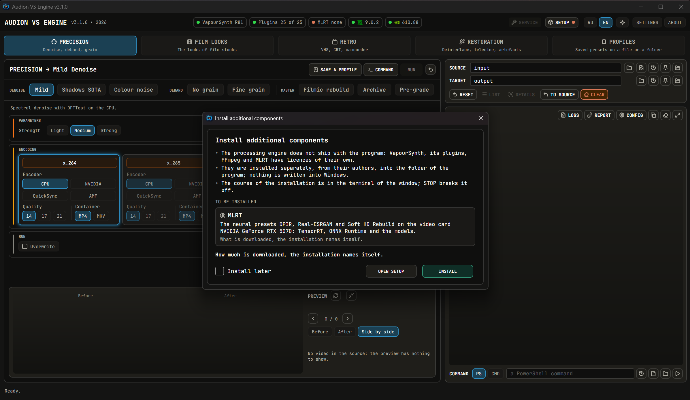

# Audion VS Engine

<!-- audion:release -->

  
  
  
  

**Version 3.1.0** · 2026-10-20 · 388.8 MB

- [Direct download](https://audion.dev/get/vs-engine/3.1.0/Audion_VS_Engine_v3.1.0_Full.zip) — unmetered, no rate limits
- [Project page](https://audion.dev/downloads/vs-engine) — every version and how to install

`SHA-256: d5edf69462aa6f3a633400c5f8e5f001296616c4fdd17e97f317fda4b256e91c`

---

An **Audion** tool, published by [Tensionix](https://github.com/Tensionix).
<!-- /audion:release -->

[English README](docs/README_EN.md) · [User Guide](docs/USER_GUIDE_EN.md) | [Русский README](docs/README_RU.md) · [Руководство](docs/USER_GUIDE_RU.md)

[Console command](docs/CLI_EN.md) · [Presets](docs/tools/VapourWiki_EN.md) · [Decisions](docs/DECISIONS_EN.md)

**Contents**

- [Why It Exists](#why-it-exists)
- [The Picture Decides](#the-picture-decides)
- [Four Palettes](#four-palettes)
- [Presets](#presets)
- [The Neural Presets](#the-neural-presets)
- [Principles](#principles)
- [What Is Inside](#what-is-inside)
- [Next](#next)
- [Technical Reference](#technical-reference)
  - [Before the First Run](#before-the-first-run)
  - [FFmpeg and the NVIDIA Driver](#ffmpeg-and-the-nvidia-driver)
  - [Camera RAW](#camera-raw)
  - [Folders](#folders)
  - [Encoding](#encoding)
  - [Profiles](#profiles)
  - [Requirements](#requirements)
  - [Licences](#licences)

A portable program for work with the picture of a video on VapourSynth and FFmpeg: denoise, deband and grain, film and
retro looks, restoration of old and over-compressed material, and on an NVIDIA RTX card neural upscaling, denoising and
frame interpolation.

## Why It Exists

VapourSynth does what no editing suite offers out of the box: a deinterlacer of reference quality, a denoiser held to
the shadows, inverse telecine, motion-compensated denoising, neural upscaling. But using it means writing a Python
script, remembering the names of plugins and assembling a pipeline by hand for every clip.

This program keeps that work in presets and gives it a window: palettes, presets grouped by the kind of processing,
a form of each preset, remembered paths, a terminal with the progress of every frame, and the visible command. Every
button of the window is an operation of the console command `vs_cli.cmd`, so the same work runs from a batch file or by
an AI agent asked in plain words.

## The Picture Decides

A preset is chosen by eye. Under the form of every preset stands its preview: the middle frame of a video of the
Source, before and after the preset with the values on the form — side by side, or one of them alone. It is counted by
itself a moment after the last change, by the same script and the same values a run takes; a count that is no longer
wanted is ended at once. The facts of the frame stand beside it: the size, the frame rate, which frame it is, and for a
denoiser the noise it measured in the source and what it made of it.

## Four Palettes

They are independent: technical processing alone, a look alone, or both one after the other.

| Palette | Presets | What it does |
|---|---|---|
| **Precision** | 8 | denoising — including one held to the shadows — debanding, a controlled return of fine grain. The technical layer **before** the colourist |
| **Film Looks** | 7 | film stocks: Kodak 35 mm, 16 mm, Super 8, IMAX 70 mm; looks: cinematic, bleach bypass, anamorphic flares |
| **Retro** | 3 | analogue character: VHS and CRT, a camcorder of the 90s, a Polaroid |
| **Restoration** | 10 | what editing suites lack: deinterlacing, inverse telecine, motion-compensated denoising, deblocking, derainbow, dehaze, upscaling; on vs-mlrt — DPIR, Real-ESRGAN, Soft HD rebuild |

**Order matters.** Precision is the technical layer that comes *before* colour grading: fixing noise after the colourist
has lifted the shadows is too late.

## Presets

Every preset where the window stands it, with the call of the console command that does the same:

<!-- map:sections -->
| Section | Group | Preset | Call |
|---|---|---|---|
| PRECISION | Denoise | Mild Denoise | `vs_cli.cmd run --operation mild_denoise` |
| PRECISION | Denoise | Shadow Denoise SOTA | `vs_cli.cmd run --operation shadow_denoise_sota` |
| PRECISION | Denoise | Chroma Cleanup | `vs_cli.cmd run --operation chroma_cleanup` |
| PRECISION | Deband | Deband Safe | `vs_cli.cmd run --operation deband_safe` |
| PRECISION | Deband | Deband Fine Grain | `vs_cli.cmd run --operation deband_fine_grain` |
| PRECISION | Master | Filmic Rebuild | `vs_cli.cmd run --operation filmic_rebuild` |
| PRECISION | Master | Archive Clean | `vs_cli.cmd run --operation archive_clean` |
| PRECISION | Master | Pregrade Prep | `vs_cli.cmd run --operation pregrade_prep` |
| FILM LOOKS | Film stock | Film 35mm | `vs_cli.cmd run --operation film_35mm` |
| FILM LOOKS | Film stock | Film 16mm | `vs_cli.cmd run --operation film_16mm` |
| FILM LOOKS | Film stock | Super 8 | `vs_cli.cmd run --operation super8` |
| FILM LOOKS | Film stock | IMAX 70mm | `vs_cli.cmd run --operation imax_70mm` |
| FILM LOOKS | Look | Cinematic | `vs_cli.cmd run --operation cinematic` |
| FILM LOOKS | Look | Bleach Bypass | `vs_cli.cmd run --operation bleach_bypass` |
| FILM LOOKS | Look | Anamorphic Scope | `vs_cli.cmd run --operation anamorphic_scope` |
| RETRO | Video | VHS CRT | `vs_cli.cmd run --operation vhs_crt` |
| RETRO | Video | Camcorder 90s | `vs_cli.cmd run --operation camcorder_90s` |
| RETRO | Photo | Polaroid | `vs_cli.cmd run --operation polaroid` |
| RESTORATION | Interlace | QTGMC Deinterlace | `vs_cli.cmd run --operation qtgmc_deinterlace` |
| RESTORATION | Interlace | TIVTC IVTC | `vs_cli.cmd run --operation tivtc_ivtc` |
| RESTORATION | Noise | MVTools MCDegrain | `vs_cli.cmd run --operation mvtools_mcdegrain` |
| RESTORATION | Noise | DPIR Denoise ¹ | `vs_cli.cmd run --operation dpir_denoise` |
| RESTORATION | Artefacts | Deblock H.264 Artefacts | `vs_cli.cmd run --operation deblock_h264_artefacts` |
| RESTORATION | Artefacts | Derainbow Decross | `vs_cli.cmd run --operation derainbow_decross` |
| RESTORATION | Artefacts | Dehaze Local Contrast | `vs_cli.cmd run --operation dehaze_local_contrast` |
| RESTORATION | Scale | NNEDI3 Upscale 2X | `vs_cli.cmd run --operation nnedi3_upscale_2x` |
| RESTORATION | Scale | Real-ESRGAN 2x ¹ | `vs_cli.cmd run --operation vsmlrt_realesrgan_2x` |
| RESTORATION | Scale | Soft HD Rebuild 2x ¹ | `vs_cli.cmd run --operation soft_hd_rebuild_2x` |
| PROFILES |  | Run a profile | `vs_cli.cmd run --operation profile_run` |

¹ on vs-mlrt: shown with an NVIDIA RTX card or MLRT.
<!-- /map -->

Each in words — what it does, on what material, its parameters — is in [the preset reference](docs/tools/VapourWiki_EN.md);
every field with its range and choices — in [OPERATIONS_EN.md](docs/OPERATIONS_EN.md).

## The Neural Presets

DPIR, Real-ESRGAN 2x and Soft HD rebuild 2x run on vs-mlrt: TensorRT on NVIDIA, ONNX Runtime, the models. The
program looks for an NVIDIA RTX card itself; with one it offers MLRT among the additional components — about 3.5 GB of downloads,
trimmed to the card, all of it inside the program's folder. Without an RTX card and without MLRT these presets are not
in the window. Where a network runs is the block PROCESSING of its page: TensorRT on RTX, DirectML on another video card,
or the processor. The first run of a model builds its TensorRT engine for 30–120 s; later runs start at once.

## Principles

- **The source is never changed.** Results go into the Target, in a folder of the palette and of the preset with its
  encoder, the folders and the name of the source kept.
- **A file is whole or it is not there.** A result is written under a name of its own and takes its name only when
  complete; STOP ends vspipe and FFmpeg and removes the half-written file. A result already there is passed over, so a
  stopped run simply starts again.
- **The denoisers measure the noise.** Seven of them measure the noise of the source before they start and grow with it;
  they never go below their settings, so clean footage gets exactly the settings.
- **The levels are kept.** A full-range source stays full range, through the filters and into the encoder.
- **The same file gives the same frames.** The grain has a fixed seed; BM3D on the processor repeats itself byte for byte.
- **Nothing is written outside the folder.** The engine, its plugins, MLRT, the indexes of the sources and the caches of
  the installers live inside it; nothing goes into Windows, the registry or PATH.

## What Is Inside

- **The window** — `Start.exe` (`App\AudionVSEngine.exe`, C# on Avalonia): palettes, groups of presets, the form, the
  preview, the paths, the terminal, SERVICE, SETUP, settings of the look.
- **The console command** — `vs_cli.cmd` on the program's own Python: every operation, its outcome as JSON, exit codes,
  a frame before and after as PNG.
- **The presets** — `.vpy` scripts in `system_core\presets\<palette>\`, each with its own description.
- **The engine** — VapourSynth with its own Python and plugins, installed by the program; FFmpeg in `Tools\ffmpeg\bin\`.
- **Menus on FZF** — `launcher_project.cmd`, `launcher_tools.cmd`, the palettes in `cli\`, the builder `builder_main.cmd`.
- **Profiles** — a preset with its values and an encoder, saved under a name.

## Next

* [User Guide](docs/USER_GUIDE_EN.md) — installing the engine, the window, the preview, profiles, the menus.
* [Console command](docs/CLI_EN.md) — `vs_cli.cmd`: commands, keys, codes, the outcome.
* [Presets](docs/tools/VapourWiki_EN.md) — every preset in words, which for which material.
* [Decisions](docs/DECISIONS_EN.md) — why things are as they are.
* [Changes](docs/CHANGELOG_EN.md).

---

## Technical Reference

### Before the First Run

The program ships without VapourSynth and its plugins — some seventy modules, each under its own licence. It installs
them itself, from their authors. A page of a preset shows the installers in their order until the engine is there, each
with what it will download; at its start the window offers to install them all or to open SETUP by one button, SETUP in the header has them too, and the builder `builder_main.cmd`:

| # | Menu entry | What it does |
|---|---|---|
| 10 | `VAPOURSYNTH` | the newest stable VapourSynth with its own Python 3.12 |
| 11 | `VS PLUGINS` | the filters the presets call, then a check that the engine loads every one of them |
| 12 / 13 | `FFMPEG …` | portable FFmpeg, chosen to match the NVIDIA driver |
| 14 | `REMOVE VAPOURSYNTH` | moves the engine — with its plugins and MLRT — to the Recycle Bin; 10 and 11 put it back |
| 71 | `VERIFY / DOCTOR` | checks the whole stack |

VapourSynth R80 and newer load only plugins built for its current interface (API 4); step 11 installs exactly those and
does not change the engine step 10 installed.

vs-mlrt for the neural presets is not a step of the builder: the window offers it at its first start and in SETUP
only when it finds an NVIDIA RTX card, trimmed to that card.

### FFmpeg and the NVIDIA Driver

Every FFmpeg build is compiled against a particular version of the hardware-encoding headers and demands its own minimum
driver. The newest build on an old driver does not accelerate anything — it breaks the hardware path. The build is
chosen to match the driver.

| NVIDIA driver | FFmpeg the program installs |
|---|---|
| no NVIDIA card | the newest stable Gyan build, 9.0.2 at least |
| **610.88** (LTS) and newer | the newest stable Gyan build, 9.0.2 at least |
| 570.0 – 610.87 | 8.0.1 (NVENC headers n13.0.19.0) — not every operation is possible |
| 551.76 – 569.xx | 7.1 (NVENC headers n12.2.72.0) — not every operation is possible |
| below 551.76 | none: the installer stops and says why |

**ProRes RAW needs 9.x.** In May 2026 the FFmpeg ProRes RAW decoder was fixed: it now reads the linearization curve
stored in the file, which removes the distortion of tones and colours seen in the picture. The fix ships with 9.0;
8.0.1 and earlier decode ProRes RAW with that distortion. 9.x also crops the frame to the sensor's active area and
passes the camera's colour parameters with every frame.

**610.88 is the LTS driver the programs are built for.** With it, or with no NVIDIA card, the newest stable FFmpeg is
installed — 9.1 when it is out — and never one older than 9.0.2. If the newest build fails the NVENC test on the driver
(a newer FFmpeg may ask a newer driver), the installer goes back to 9.0.2. Below 610.88 an older branch is installed so
that NVENC works, and the installer, the plan of the download and the badge of FFmpeg in the header say that not every
operation is possible — what needs FFmpeg 9.x, such as ProRes RAW decoded right. The build is picked at installation:
when the driver changes, FFmpeg installed again in SETUP is picked for it. 7.1.1 does not help an older driver: it was built with the same
headers as 8.0.1 and needs the same 570.0 — only 7.1 does.

### Camera RAW

The engine does not read camera RAW: the sources of VapourSynth see no picture in it. A Source of RAW alone is refused
before the run, among other videos such a file fails by itself and the rest are made; the preview says the same. The
line names the program that opens it and its page: there it is converted into ProRes 4444 or DNxHR 444, and the preset
is run on that. The programs are installed by the person, from their makers and under their terms: VS Engine neither
downloads nor carries them.

| RAW | Files | What opens it |
|---|---|---|
| ProRes RAW, ProRes RAW HQ | `.mov` | [DaVinci Resolve](https://www.blackmagicdesign.com/products/davinciresolve), [Final Cut Pro](https://www.apple.com/final-cut-pro/) |
| ARRIRAW, ARRIRAW HDE | `.mxf`, `.ari`, `.arx` | [ARRI Reference Tool](https://www.arri.com/en/learn/camera-systems/tools/arri-reference-tool), DaVinci Resolve |
| RED R3D | `.r3d` | [REDCINE-X PRO](https://www.reddigitalcinema.com/download/redcine-x-pro-win), DaVinci Resolve |
| Nikon N-RAW | `.nev` | DaVinci Resolve, REDCINE-X PRO |
| Blackmagic RAW | `.braw` | [Blackmagic RAW Player](https://www.blackmagicdesign.com/products/blackmagicraw), DaVinci Resolve |
| Sony RAW, X-OCN | `.mxf` | [Sony RAW Viewer](https://www.sony.jp/ls-camera/download/rawviewer/), DaVinci Resolve |
| Canon Cinema RAW, Cinema RAW Light | `.rmf`, `.crm` | [Canon Cinema RAW Development](https://hk.canon/en/support/0200767202), DaVinci Resolve |

### Folders

| Folder | What it holds |
|---|---|
| `input\` | the Source by default: every video of the folder and of its subfolders |
| `output\` | the Target by default: `<Palette>\<preset>_<encoder>\<the folders of the Source>\<name>.<ext>`; a profile — `Profiles\<profile>_<encoder>\` |
| `logs\` | the journal of every run |
| `report\` | the report of every run (`run_report.json`, `.md`) and a JSON of every file |
| `config\` | the operations and their texts (`tool_manifest.yaml`), the layout of the window, the profiles, the settings of the window |

### Encoding

34 encoders: x264 and x265 at the quality ladder 14 / 17 / 21, ProRes LT, 422, 422 HQ in MOV or MXF, DNxHR LB, SQ, HQ,
HQX, and the same ladder on NVENC, QuickSync and AMF. In the window they are four cards — x264, x265, ProRes, DNxHR — with
the encoder, the quality and the container inside. A hardware encoder this machine has not passed SERVICE → Hardware
capabilities is switched off with the reason. Sound is copied; ProRes going into x264 or x265 gets AAC 384 kbps, MXF — PCM 24 bit at 48 kHz.

### Profiles

| Name | Preset |
|---|---|
| `shadow_clean_quick` | Shadow Denoise SOTA — a quick clean of the shadow noise of dark digital footage |
| `filmic_warm_35mm` | Film 35mm — Kodak 250D at intensity 1.0 |
| `archival_master` | Archive Clean — a neutral archival master in ProRes 422 HQ |
| `resolve_handoff` | Pregrade Prep — the minimum before DaVinci Resolve, ProRes 422 HQ |
| `vhs_dreamy` | VHS CRT at intensity 1.2 |

SAVE A PROFILE on a page of a preset keeps it with the values of the page and the encoder of the cards in
`config\profiles\<name>.json`.

### Requirements

- Windows 10/11 x64; about 1.2 GB on disk with the engine; MLRT adds about 3.5 GB.
- No system Python, VapourSynth or FFmpeg.
- A video card with a Vulkan driver is optional: it runs BM3D; without it BM3D runs on the processor.
- The neural presets need an NVIDIA RTX card to be installed; installed, they run on another card through DirectML or on
  the processor, many times slower.

### Licences

The engine is separate programs under their own licences: the program calls them and does not build them in. VapourSynth
is under LGPL 2.1, each plugin under its own (GPL, LGPL, MIT, ISC — `install\vs_plugins.json`), FFmpeg's build is GPL v3
with its sources beside it in `Tools\`, vs-mlrt and its runtimes — TensorRT, ONNX Runtime — under theirs. None of them is
in the release: the program installs them from their authors.
